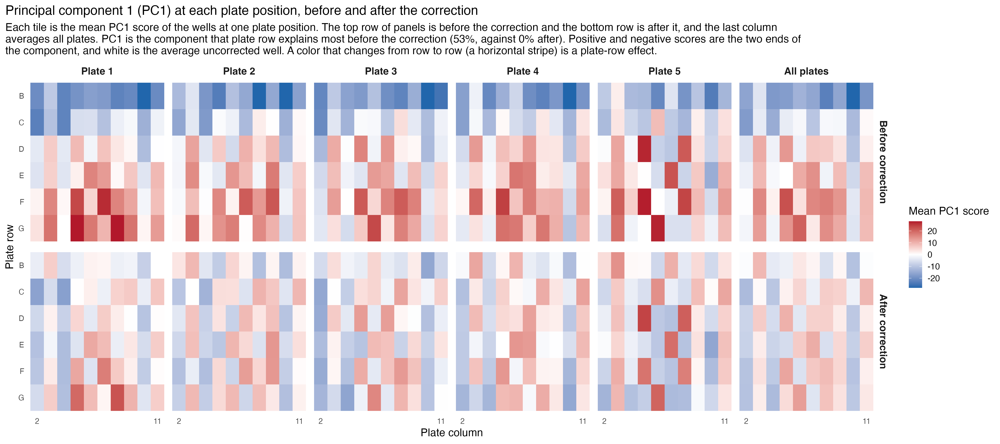
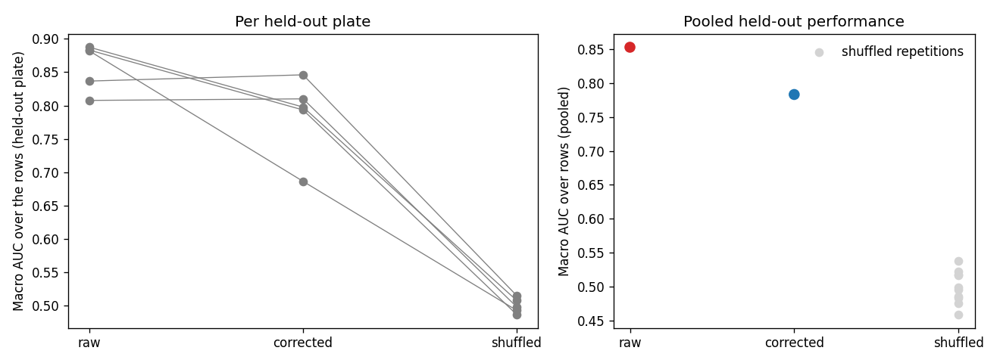
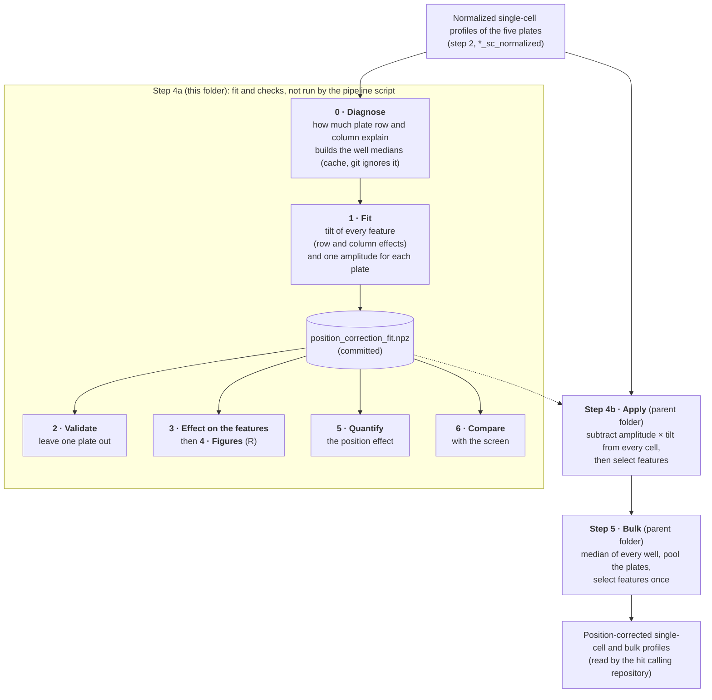

# Plate-position correction of the validation plates (step 4a)

On the five validation plates, the position of a well on the plate shifts its profile in a consistent, feature-specific direction (a "tilt") that has nothing to do with what is in the well.
The effect is strong: the first principal component of the wells, the main direction in which the wells differ, falls from row B to row G on every plate.
Plate row explains 53% of it (see the figure below and [the supplementary details](./POSITION_CORRECTION_SUPPLEMENTARY_DETAILS.md#1-the-validation-plates-have-a-strong-position-effect)).
The screen has the same kind of effect, and its correction ([`4.image_based_profiling/3a.position_correction/`](../../../4.image_based_profiling/3a.position_correction/)) is the model for this one.


*The first principal component of the wells at every plate position (Figure 2 of the [supplementary details](./POSITION_CORRECTION_SUPPLEMENTARY_DETAILS.md)).
The color changes from row to row in the same way on all five plates, so the rows form stripes.*

This folder fits the correction on the validation plates, tests it on held-out plates, and draws the same figures as the screen.
It does not write corrected profiles: [`../4b.apply_position_correction.ipynb`](../4b.apply_position_correction.ipynb) applies the fit to the single cells (the step 3b of the screen), and [`../5.bulk_position_corrected.ipynb`](../5.bulk_position_corrected.ipynb) aggregates the corrected cells to bulk profiles (the bulk step of the screen).
"4a" is the name of this folder, not of a notebook: the steps 4a, 4b, and 5 of the validation plate module follow the steps 0 to 3.
Like in the screen, the pipeline script does not run this step: it reads the committed fit, `position_correction_fit.npz`.

The validation plates keep their own feature names (the d2 channel is `Golgi`), and the correction is fit on the validation plates only.

## The takeaway

The validation plates have a strong plate-position effect, and a row plus column correction removes most of it without removing the difference between non-failing and failing cells.

- **The effect is strong, and it is the plate row.** The first principal component of the wells (48% of the variance) is 53% explained by plate row and 20% by plate column, and it is also there within the DMSO wells of one cell type alone (69% of PC1 in the failing wells and 76% in the non-failing wells), so it is not the biology.
- **The correction is a tilt for every feature, scaled for every plate.** The tilt is a row effect plus a column effect (see "What the tilt is" below), fit together with one offset for each group of wells so that what a compound or a cell type does is not counted as position.
- **It removes the row effect on the plates it was fit on**: plate row explains 53% of PC1 before and 0% after, and the position share of the variance in the first 20 components falls from 43.2% to 12.6%.
- **It works on a plate it never saw, but only partly.** A classifier of the plate row falls from an AUC of 0.85 to 0.78 (the screen: 0.76 to 0.52), the median share of the variation of a feature that is position falls from 0.26 to 0.05 on held-out plates, and the wells in the top row stay furthest from their cell type. On the DMSO wells alone the row AUC does not fall (0.87 and 0.89), and we have not tested why.
- **It keeps the biology.** The distance between the non-failing and the failing DMSO profiles does not change on these plates (both cell types are in every row, so the row effects cancel; this is an observed result and not a guarantee, because the column effects and an uneven cell filter could change it), and the row effect of one cell type predicts that of the other (cosine 0.92).
- **What is left is not determined by these plates.** The failing DMSO, the non-failing DMSO, and the compounds are in different blocks of columns, so the column effects cannot be told from the group offsets (none of the nine column terms is more than 2 times its uncertainty), and the rows carry the correction. Each compound is on one plate only.



*PC1 at every plate position before (top) and after (bottom) the correction, on the plates that the tilt was fit on (Figure 11 of the [supplementary details](./POSITION_CORRECTION_SUPPLEMENTARY_DETAILS.md)).*



*The AUC of a classifier that predicts the plate row of the wells of a plate that the tilt and the classifier never saw (Figure 7 of the [supplementary details](./POSITION_CORRECTION_SUPPLEMENTARY_DETAILS.md)).*

We tested the position effect and the correction in 11 ways, from whether the effect is row or biology to whether the screen fits its own assumptions.
The [supplementary details](./POSITION_CORRECTION_SUPPLEMENTARY_DETAILS.md) have each test with its figures, and the first table there has the question and the answer of each in one line.

## Workflow



The dotted arrow shows an input that a step reads.
Notebooks 2 to 6 read the fit and the well medians, and write only figures and tables (`figures/`, `results/`).

## The validation plates

All five replicate plates have 60 wells (rows B to G, columns 2 to 11):

| Wells | Cells | Where |
|---|---|---|
| 18 failing DMSO (negative control) | failing (heart 25) | columns 2, 4, and 10 (all six rows), identical positions on all plates |
| 18 non-failing DMSO | non-failing (heart 7) | columns 3, 9, and 11 (all six rows), identical positions on all plates |
| 24 compound wells | failing (heart 25) | columns 5 to 8 (all six rows) |

There are 15 compounds (K020, K191, K208, K221, K278, K310, K318, K463, K504, K543, K645, K687, K756, K779, K845).
Each plate holds three of them in 8 wells each, and each compound is on one plate only, at positions that differ between plates.
Plate 1, for example, holds K278, K310, and K543.

This layout differs from the screen in three ways that matter for the correction:

- The screen places each compound once on each of 11 platemaps and the same controls everywhere, so compound effects average out of its tilt estimate.
  Here a compound is on one plate, so its effect has to be fit together with the tilt (one effect for each compound, `fit_compound_adjusted_tilt` in [`utils/validation_position_utils.py`](../../../utils/validation_position_utils.py)).
- The DMSO wells of both cell types are the only wells that repeat at the same position on five plates.
  Within a cell type, the difference between positions is position, and the difference between plates is noise.
  So the fit uses the DMSO wells too (`include_controls=True`), and the measurements of this folder that need replicates use only the DMSO wells.
- **The groups sit in blocks of columns.**
  Every row has the same number of wells of each kind (three failing DMSO and three non-failing DMSO), so row is not confounded with the cell type, but the failing DMSO, the non-failing DMSO, and the compounds each have their own columns.
  A group effect can therefore absorb the offset of its block of columns, and three column offsets cannot be told from the group effects (on one plate the design has 20 columns and rank 17).
  An unconstrained fit splits those offsets between group and column effects arbitrarily, which changes the difference between the non-failing and the failing controls.
  The fit has no reference column and a tiny ridge penalty on the column effects, which sets what the data cannot determine to zero and leaves the effects that they do determine as they are.

**What the tilt is.**
The correction subtracts a position effect, the *tilt*, from every cell.
For one feature, the tilt of a well is the effect of its row plus the effect of its column: for a well in row F and column 7, it is the row F effect plus the column 7 effect of that feature.
A feature has five row effects (rows C to G against row B) and ten column effects (reported against column 2), so 15 tilt numbers, and each of the 2,453 features has its own.
Features are affected unequally: Actin features most (median tilt size 0.34 standard deviations of a single cell, against 0.09 to 0.16 in the other channels), and intensity and texture measurements (Figure 3 of the [supplementary details](./POSITION_CORRECTION_SUPPLEMENTARY_DETAILS.md)).
[`results/tilt_size_by_feature.csv`](./results/tilt_size_by_feature.csv) has the tilt size of every feature.

**What the fit also estimates.**
The fit estimates the tilt together with one offset for each group of wells: each of the 15 compounds, the failing DMSO, and the non-failing DMSO (17 offsets).
These group offsets are the part of the profile that does not depend on position (what a compound or a kind of cell does).
They keep that part from being counted as position, and the correction does not subtract them.
In all, the fit has 32 parameters for each feature (5 row effects, 10 column effects, and 17 group offsets).
A parameter here is a number that the data determine, not a setting to toggle, and three combinations of them are not determined by the layout (see "The groups sit in blocks of columns").
The fit uses the 17 groups with the replicate plates averaged (36 DMSO positions and 15 compounds at 8 positions each), and fits each feature on its own.
"The fit" is this estimation (`1.fit_position_correction.ipynb`), and "the tilt" is the part of its result that the correction subtracts.

**The amplitude.**
Each plate has one amplitude, a single number for all of its features: it says how strongly the tilt shows on that plate (1 means that the plate follows the tilt as fitted).
A cell is corrected by subtracting, from each of its features, the amplitude of its plate times the tilt of its well for that feature.

## Notebooks

| Notebook | What it does | Screen counterpart |
|---|---|---|
| [`0.diagnose_position_effect.ipynb`](./0.diagnose_position_effect.ipynb) | Diagnoses the uncorrected plates: how much of each principal component plate row and column explain (in all wells, in the DMSO wells of one cell type, and in the DMSO wells without the cell-type effect), and whether the effect works through the number of cells | none (it motivates the correction) |
| [`1.fit_position_correction.ipynb`](./1.fit_position_correction.ipynb) | Estimates the tilt (with one effect for each compound and each kind of DMSO), writes `position_correction_fit.npz` (with the name of the plate that owns each amplitude; it stops before saving if a plate has no finite amplitude), and measures the amplitude of each replicate plate and the effect on the controls | `0.fit_position_correction` |
| [`2.validate_position_correction.ipynb`](./2.validate_position_correction.ipynb) | Tests the correction on held-out plates with a row classifier, and checks on a simulation that the fit recovers a known tilt | `1.validate_position_correction` |
| [`3.effect_on_feature_space.ipynb`](./3.effect_on_feature_space.ipynb) | Computes the size of the tilt by feature family and the principal components of the wells before and after the correction | `2.effect_on_feature_space` |
| [`4.plot_effect_on_feature_space.ipynb`](./4.plot_effect_on_feature_space.ipynb) (R) | Draws the effect figures from those tables | `3.plot_effect_on_feature_space` |
| [`5.quantify_position_effect.ipynb`](./5.quantify_position_effect.ipynb) | Measures the position effect directly: the position variation of every feature within the DMSO groups, position against biology, whether the row effect carries over between cell types, the DMSO wells on the layout of each plate, and how well each term of the tilt is determined, before and after the correction | none |
| [`6.compare_position_effects_in_validation_to_screen.ipynb`](./6.compare_position_effects_in_validation_to_screen.ipynb) | Puts the validation plates next to the screen: the variance of the principal components associated with position and with heart status, the survival of the non-failing against failing difference, and the placement of compounds on the screen platemaps | none |

Run them in order, from this folder (the paths are relative to it, so a script of [`nbconverted/`](./nbconverted/) has to be run with this folder as the working directory, for example `uv run python nbconverted/0.diagnose_position_effect.py`).
Every notebook has a script version in `nbconverted/`.
The first one that needs the single-cell profiles reads the five `<plate>_sc_normalized.parquet` files (about 1.4 GB, on bandicoot at `~/mnt/bandicoot/CFReT_screening_data/validation_profiles/single_cell_profiles/`, or in the folder that `VALIDATION_PROFILE_DIR` names) and caches the median profile of every well in `well_medians.parquet`, which git ignores.
The cache is not checked against the profiles: the notebooks warn with the date on which it was written, and `REBUILD_WELL_MEDIANS=1` builds it again from the profiles (do this whenever the single-cell profiles change).
The R notebook needs R with `ggplot2`, `dplyr`, `readr`, and `cowplot`.

Differences from the screen:

| | Screen | Validation plates |
|---|---|---|
| Tilt | one shared tilt, fit on compounds placed at random on 11 platemaps | one tilt fit on the compound wells and the DMSO wells of both cell types, with one effect for each compound and each kind of DMSO, and a ridge penalty on the column effects (blocks of columns cannot be told from the group effects) |
| Amplitude | one per platemap, shrunk toward the others | one per replicate plate, shrunk toward the others like the platemaps of the screen: 1.05, 0.92, 0.92, 0.95, and 0.82 for plates 1 to 5 (before shrinking: 1.10, 0.92, 0.92, 0.96, and 0.71) |
| Held-out validation | leave one platemap out | leave one plate out (the tilt is fit on four plates and applied to the fifth) |
| Figures of the principal components | the two components that plate row explains most | PC1, which plate row explains most and which is also the largest, and PC8, the next that plate row explains most |

## Assumptions and limits

- Position adds the same fixed vector to every cell of a well, the same for every compound and cell type (additive, no interaction of row and column, no effect that differs between compounds or cell types).
  [Test 9](./POSITION_CORRECTION_SUPPLEMENTARY_DETAILS.md#9-the-row-effect-of-one-cell-type-predicts-the-row-pattern-of-the-other) tests the last part for the rows, where it is approximately true between the two cell types; this layout cannot test it for the columns.
- The five replicate plates share the DMSO layout, so they reduce noise, but the compounds are on one plate each.
  The compound effects are fit, not replicated, and the 8 positions of a compound (columns 5 to 8, in all six rows) are what separate its effect from position.
- A compound sits in the wells of one of three fixed sets (slots A, B, and C) that are the same on every plate, so an effect of the slot cannot be told from the effect of the compound, and this tilt does not remove it. The compounds of slot A score lower than those of the other two on every plate: see [`../4c.slot_a_adjustment/`](../4c.slot_a_adjustment/README.md).
- The groups sit in blocks of columns (failing DMSO in columns 2, 4, and 10, non-failing DMSO in 3, 9, and 11, compounds in 5 to 8), so a column effect is confounded with the cell type and the compounds, and only the differences between columns inside a block are determined.
  The column terms of the tilt are therefore not reliable, and the row terms carry the correction.
- The held-out test is held out by plate, so it tells how the correction works for a new plate on this layout, not for a new layout.
- We use wells with at least 50 cells, and we drop features with a missing value in any well (no feature of these data has one on any plate, so the features are the same for every plate; the cache keeps a record of what it dropped).
- The principal-component figures fit the components on the uncorrected wells and project the corrected wells into them, as in the screen.

## Contents

```text
4a.position_correction/
├── 0.diagnose_position_effect.ipynb                          Diagnose the uncorrected plates
├── 1.fit_position_correction.ipynb                           Fit the tilt
├── 2.validate_position_correction.ipynb                      Test it on held-out plates
├── 3.effect_on_feature_space.ipynb                           Tables of the effect on the features and the wells
├── 4.plot_effect_on_feature_space.ipynb                      Figures of the effect (R)
├── 5.quantify_position_effect.ipynb                          Measure the position effect directly
├── 6.compare_position_effects_in_validation_to_screen.ipynb  Compare the validation plates with the screen
├── POSITION_CORRECTION_SUPPLEMENTARY_DETAILS.md              The tests behind the takeaway, with their figures
├── nbconverted/                                              Script version of each notebook
├── position_correction_fit.npz                               The tilt map and amplitude (committed; step 4b reads it)
├── results/                                                  Tables that later notebooks read
├── figures/                                                  Figures (diagnostics/, fit/, validation/, effect/, quantify/, compare_to_screen/)
└── well_medians.parquet                                      Median profile of every well (git ignores this cache)
```
