# Plate-position correction of the validation plates (step 4a)

In the screen, the position of a well on the plate shifts its profile in a consistent, feature-specific direction (a "tilt") that has nothing to do with what is in the well.
The screen estimates the tilt, validates it on held-out platemaps, and subtracts it ([`4.image_based_profiling/3a.position_correction/`](../../../4.image_based_profiling/3a.position_correction/)).

This folder does the same for the five validation plates, before we call hits on them.
It fits the correction, validates it on held-out plates, and draws the same figures as the screen.
[`../4b.apply_position_correction.ipynb`](../4b.apply_position_correction.ipynb) applies the fit to the single cells (the step 3b of the screen), and [`../5.bulk_position_corrected.ipynb`](../5.bulk_position_corrected.ipynb) aggregates the corrected cells to bulk profiles (the bulk step of the screen).
Like in the screen, the pipeline script does not run this step: it reads the committed fit, `position_correction_fit.npz`.

The validation plates keep their own feature names (the d2 channel is `Golgi`), and the correction is fit on the validation plates only.

## The validation plates

All five replicate plates have 60 wells (rows B to G, columns 2 to 11):

| Wells | Cells | Where |
|---|---|---|
| 18 failing DMSO (negative control) | failing (heart 25) | columns 2, 4, and 10 (all six rows), identical positions on all plates |
| 18 healthy DMSO | non-failing (heart 7) | columns 3, 9, and 11 (all six rows), identical positions on all plates |
| 24 compound wells | failing (heart 25) | columns 5 to 8 (all six rows) |

There are 15 compounds (K020, K191, K208, K221, K278, K310, K318, K463, K504, K543, K645, K687, K756, K779, K845).
Each plate holds three of them in 8 wells each, and each compound is on one plate only, at positions that differ between plates.
Plate 1, for example, holds K278, K310, and K543.

This layout differs from the screen in three ways that matter for the correction:

- The screen places each compound once on each of 11 platemaps and the same controls everywhere, so compound effects average out of its tilt estimate.
  Here a compound is on one plate, so its effect has to be fit together with the tilt (one effect for each compound, `fit_compound_adjusted_tilt` in [`utils/validation_position_utils.py`](../../../utils/validation_position_utils.py)).
- The DMSO wells of both cell types are the only wells that repeat at the same position on five plates.
  Within a cell type, the difference between positions is position, and the difference between plates is noise.
  So the fit uses the DMSO wells too (`include_controls=True`), and the measurements of this folder that need replicates use only the DMSO wells.
- **The groups sit in blocks of columns.** Every row has the same number of wells of each kind (three failing DMSO and three healthy DMSO), so row is not confounded with the cell type, but the failing DMSO, the healthy DMSO, and the compounds each have their own columns.
  A group effect can therefore absorb the offset of its block of columns, and three column offsets cannot be told from the group effects (on one plate the design has 20 columns and rank 17).
  An unconstrained fit splits those offsets between group and column effects arbitrarily, which changes the difference between the healthy and the failing controls.
  The fit has no reference column and a tiny ridge penalty on the column effects, which sets what the data cannot determine to zero and leaves the effects that they do determine as they are.

**What the tilt is.** The correction subtracts from every feature a position effect, the sum of one effect for the row and one for the column of a well.
The fit of a feature has one effect for each group (15 compounds and 2 kinds of DMSO), five row effects (rows C to G against row B), and ten column effects with a ridge penalty (reported against column 2): 32 parameters, of which three combinations are not determined by the layout.
It is fit on the 17 groups, with the replicate plates averaged (36 DMSO positions and 15 compounds at 8 positions each), once for each of the 2,453 features.
The group effects keep what a compound or a cell type does from being counted as position.

## Notebooks

| Notebook | What it does | Screen counterpart |
|---|---|---|
| [`0.diagnose_position_effect.ipynb`](./0.diagnose_position_effect.ipynb) | Diagnoses the uncorrected plates: how much of each principal component plate row and column explain (in all wells, in the DMSO wells of one cell type, and in the DMSO wells without the cell-type effect), and whether the effect works through the number of cells | none (it motivates the correction) |
| [`1.fit_position_correction.ipynb`](./1.fit_position_correction.ipynb) | Estimates the tilt (with one effect for each compound and each kind of DMSO), writes `position_correction_fit.npz` (with the name of the plate that owns each amplitude; it stops before saving if a plate has no finite amplitude), and measures the amplitude of each replicate plate and the effect on the controls | `0.fit_position_correction` |
| [`2.validate_position_correction.ipynb`](./2.validate_position_correction.ipynb) | Tests the correction on held-out plates with a row classifier, and checks on a simulation that the fit recovers a known tilt | `1.validate_position_correction` |
| [`3.effect_on_feature_space.ipynb`](./3.effect_on_feature_space.ipynb) | Computes the size of the tilt by feature family and the principal components of the wells before and after the correction | `2.effect_on_feature_space` |
| [`4.plot_effect_on_feature_space.ipynb`](./4.plot_effect_on_feature_space.ipynb) (R) | Draws the effect figures from those tables | `3.plot_effect_on_feature_space` |
| [`5.quantify_position_effect.ipynb`](./5.quantify_position_effect.ipynb) | Measures the position effect directly: the position variation of every feature within the DMSO groups, position against biology, whether the row effect carries over between cell types, the DMSO wells on the layout of each plate, and how well each term of the tilt is determined, before and after the correction | none |
| [`6.compare_position_effects_in_validation_to_screen.ipynb`](./6.compare_position_effects_in_validation_to_screen.ipynb) | Puts the validation plates next to the screen: the variance of the principal components associated with position and with heart status, the survival of the healthy against failing difference, and the placement of compounds on the screen platemaps | none |

Run them in order, from this folder (the paths are relative to it, so a script of [`nbconverted/`](./nbconverted/) has to be run with this folder as the working directory, for example `uv run python nbconverted/0.diagnose_position_effect.py`).
Every notebook has a script version in `nbconverted/`.
The first one that needs the single-cell profiles reads the five `<plate>_sc_normalized.parquet` files (about 1.4 GB, on bandicoot at `~/mnt/bandicoot/CFReT_screening_data/validation_profiles/single_cell_profiles/`, or in the folder that `VALIDATION_PROFILE_DIR` names) and caches the median profile of every well in `well_medians.parquet`, which git ignores.
Delete the cache whenever the single-cell profiles change.
The R notebook needs R with `ggplot2`, `dplyr`, `readr`, and `cowplot`.

Differences from the screen:

| | Screen | Validation plates |
|---|---|---|
| Tilt | one shared tilt, fit on compounds placed at random on 11 platemaps | one tilt fit on the compound wells and the DMSO wells of both cell types, with one effect for each compound and each kind of DMSO, and a ridge penalty on the column effects (blocks of columns cannot be told from the group effects) |
| Amplitude | one per platemap, shrunk toward the others | one per replicate plate, shrunk toward the others like the platemaps of the screen: 1.05, 0.92, 0.92, 0.95, and 0.82 for plates 1 to 5 (before shrinking: 1.10, 0.92, 0.92, 0.96, and 0.71) |
| Held-out validation | leave one platemap out | leave one plate out (the tilt is fit on four plates and applied to the fifth) |
| Figures of the principal components | the two components that plate row explains most | PC1, which plate row explains most and which is also the largest, and PC8, the next that plate row explains most |

## What we found

**1. The validation plates have a strong position effect.**

- The first principal component of the wells (48% of the variance) is 53% explained by plate row and 20% by plate column (chance is about 2% and 3%; Figure 1 and Figure 2).
  In the screen, plate row explained 25% of PC3 and 10% of PC2, the components that depend most on it, and 1% of PC1.
- It is not the effect of the cell type or of the compounds.
  Among the failing DMSO wells alone, which are one treatment on one cell type, PC1 (54% of their variance) is 69% explained by plate row and 7% by plate column (Figure 5).
  Among the healthy DMSO wells alone, PC1 (57%) is 76% explained by row and 4% by column.
  After we average the five plates and remove the mean of each cell type, what remains differs only between the 36 positions, and PC1 of that (79%) is still 84% explained by row and 6% by column.
- The effect is strongest in Actin features (median tilt size 0.34 standard deviations of a single cell, against 0.09 to 0.16 in the other channels) and in intensity and texture measurements, as in the screen (Figure 3).

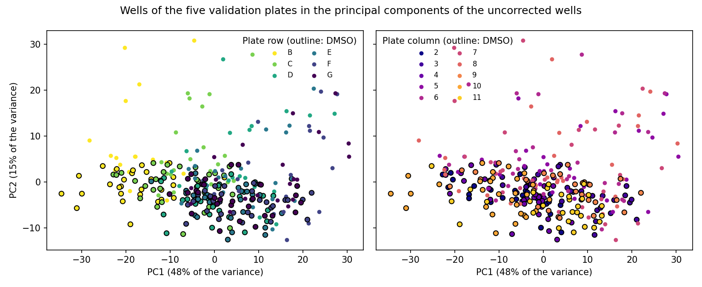

*Figure 1. Wells in the principal components of the uncorrected wells. Each point is a well, placed by its first two principal components and colored by plate row (left) or plate column (right); DMSO wells have an outline. The rows separate along PC1 and the columns do not.*

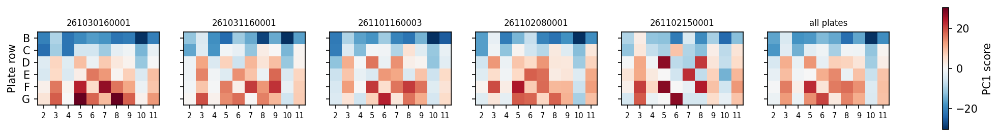

*Figure 2. PC1 at every plate position. The color changes from row to row (horizontal stripes), in the same way on all five plates.*

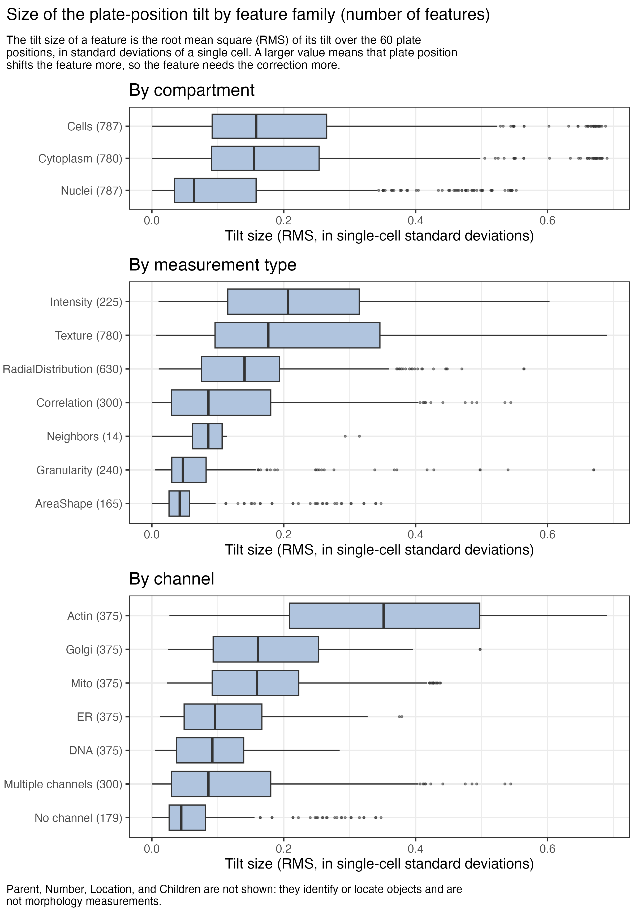

*Figure 3. How far plate position moves a feature, by compartment, measurement type, and channel. Actin, intensity, and texture features move the most.*

*Compared with the screen (Figure 4).* We fit the components as the screen analysis does (for the screen, on all 2,088 wells) and show the first 20, on one y axis.
The numbers below are the parts of the variance that are associated with position and with heart status; they overlap and do not add up (see below).
In the screen, plate position (row plus column) is in PC2 and PC3: it is associated with 10% of PC2 and 27% of PC3 (row alone: 10% and 25%), and 4% of PC1.
In all, it is associated with 6.8% of the total variance in the first 20 principal components of the screen wells (85.7% of the total variance; row alone 5.5%), and 1.4% after the correction (row alone 1.1%).
On the validation plates it is in PC1, which holds 47.9% of the total variance, and position is associated with 34.4 points of it (21.1% of the total variance remain in PC1 after the correction, 8.1 points of it position).
In all, position is associated with 43.2% of the total variance in the first 20 components of the validation wells (94.6% of the total variance; row alone 27.6%), and 12.6% after the correction (row alone 0.1%).
So after the correction the row is gone and what remains is associated with the columns, which are confounded with the groups (finding 7).
Heart status (healthy against failing) is associated with 4.1% of the total variance before and after the correction on the validation plates, against 1.3% and 0.7% in the screen.
**The position and the heart status parts overlap on the validation plates:** the healthy wells are in columns 3, 9, and 11 and no other wells are, so the healthy label is the sum of three column indicators, and a component that follows only the healthy columns is counted in both.
The heart status part is therefore not variance that position does not explain. The row part is not confounded with heart status, because every row has three wells of each cell type.
The 12.6% after the correction is in-sample (see finding 7), so it is an optimistic figure; the held-out figure is in finding 5.

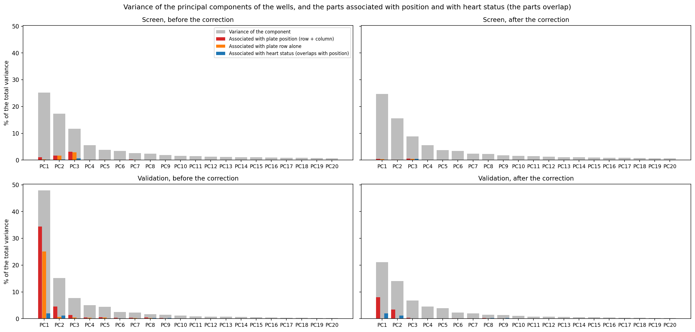

*Figure 4. The variance of each principal component (grey), with the part that is associated with plate position (red, row plus column), with plate row alone (orange), and with heart status (blue), before and after the correction. The parts overlap. The screen is on top and the validation plates at the bottom.*

**2. The number of cells in a well is associated with the row.**
The median number of cells in a DMSO well falls from 257 in row B and 260 in row C to 226 in row F and 203 in row G (Figure 5).
Within a cell type, the cell number correlates with the row (-0.63 after the mean of the cell type is removed), and the cell type explains none of the variation in cell number.
In the failing DMSO wells, plate row explains 69% of PC1 and the log number of cells 5%; together 70%.
In the healthy DMSO wells row explains 76%, cell number 33%, and together 81%.
These are associations: they do not show that position acts through the cell number, which could also respond to position or share a cause with it.
A correction by position removes the part of the cell-number pattern that follows position, and we do not model the cell number separately.

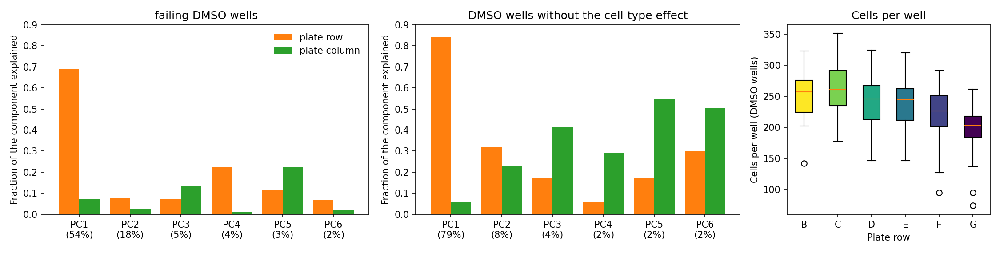

*Figure 5. Left and middle: the fraction of each component that plate row and plate column explain, in the failing DMSO wells and in the DMSO wells without the cell-type effect. Right: cells per DMSO well by plate row.*

**3. The five plates do not show the effect equally.**
The amplitude of the tilt is 1.10 (plate 1), 0.92 (plate 2), 0.92 (plate 3), 0.96 (plate 4), and 0.71 (plate 5), with standard errors of 0.05 to 0.07 (Figure 6).
Plate 5 is about five standard errors away from 1, and plate 1 about two, so one tilt for all plates is an approximation.
Like the screen, the correction uses each plate's amplitude shrunk toward the average of the others (1.05, 0.92, 0.92, 0.95, and 0.82).
The fit file stores which plate owns each amplitude, so a plate gets its own amplitude whichever other plates are processed with it.

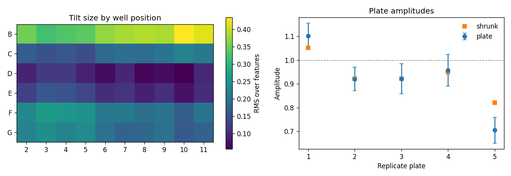

*Figure 6. Left: the size of the tilt at every well position. Right: the amplitude of each plate with its standard error (blue) and after shrinking (orange).*

**4. The correction works on held-out plates, but only partly.**
The table gives the leave-one-plate-out result: the AUC of a classifier that predicts the plate row of the wells of a plate that neither the tilt nor the classifier saw (0.5 is chance; shuffled labels, repeated several times, give the floor; Figure 7).

| | raw | corrected | shuffled labels |
|---|---|---|---|
| All wells: AUC over the rows | 0.85 | 0.78 | 0.50 (sd 0.02) |
| All wells: row B against the rest | 0.98 | 0.74 | 0.45 (sd 0.09) |
| DMSO wells: AUC over the rows | 0.87 | 0.89 | 0.51 (sd 0.02) |
| DMSO wells: row B against the rest | 0.99 | 0.85 | 0.44 (sd 0.09) |

- The correction removes 20% of the excess AUC over the rows in all wells and 46% of the excess for row B against the rest.
  On the DMSO wells alone the AUC over the rows does not fall.
  The DMSO positions are the same on every plate, so a classifier can learn the pattern of a well from the other plates, which a row plus column tilt does not contain; we have not tested whether this is the reason.
  In the screen, the same test took the pooled AUC from 0.76 to 0.52.
- On each plate separately, the AUC over the rows goes from 0.88 to 0.69 (plate 1), 0.88 to 0.79 (plate 2), 0.89 to 0.80 (plate 3), 0.84 to 0.85 (plate 4), and 0.81 to 0.81 (plate 5).
- In a simulation on the real layout, the fit with one effect for each group recovers the tilt that the layout can identify (the true column effects are centered within the three blocks of columns; median cosine 1.00), and the screen's way of fitting, without group effects, reaches 0.77.
- The held-out test selects the features on all plates. No feature has a missing value on any plate in these data, so the held-out plate does not influence the selection; `2.validate_position_correction.ipynb` checks this.


*Figure 7. The AUC of the row classifier on the held-out plate, per plate (left) and pooled (right), for the uncorrected wells, the corrected wells, and shuffled labels.*

**5. The position variation of the features falls, but does not vanish.**
Of the variation within the DMSO groups, the share that is position (with the chance level subtracted) has a median of 0.26 per feature before the correction, and 55% of the features are above 0.2 (Figure 8).
After a tilt fit on all plates it is 0.10 (36% above 0.2), which a fit on its own data always favors.
After a tilt that never saw the plate (held-out) it is 0.05 (28% above 0.2).
For a median feature with a clear position effect (share above 0.2, 1,335 features), the held-out correction removes 85% of the position variation (quartiles 67% to 92%), and 6% of these features get worse.
Overall 14% of the position variation is left after the in-sample correction and 8% after the held-out one.
The held-out figure being lower than the in-sample one is not credible as a real gain: the measure subtracts a noise level estimated from the differences between plates, and the five held-out corrections differ a little between plates, which adds to that noise.
We take the two figures to be about equal, and the remaining position variation to be 8% to 14%.
Of the 1,335 features with a clear position effect, 113 (8%) keep at least 80% of it after the held-out correction: 48 DNA, 29 without a channel, 13 ER, 12 Golgi, 5 multi-channel, 5 Mito, and 1 Actin feature.

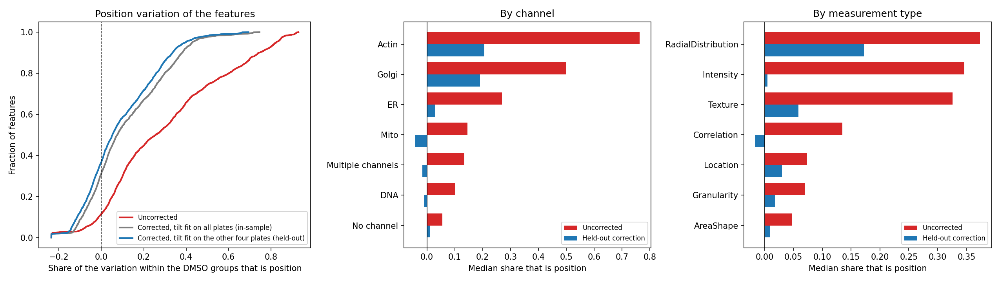

*Figure 8. Left: the share of the variation that is position, for every feature, uncorrected (red), after the in-sample correction (grey), and after the held-out correction (blue). Middle and right: the median share by channel and by measurement type.*

**6. The wells at the top edge stay furthest from their cell type.**
The mean distance of a DMSO well from the mean profile of its cell type is 19.4 in row B and 9.8 to 12.0 in the other rows before the correction, so the wells at the top edge of the plate sit furthest from the mean of their cell type.
After the held-out correction it is 12.6 in row B and 9.2 to 11.2 in the others (row B keeps 65% of its distance, rows C to G 81% to 96%).
The corrected distance is close to the noise between replicate plates, so only row B stands out, and it still does.
The same pattern holds on all five plates (Figure 9).

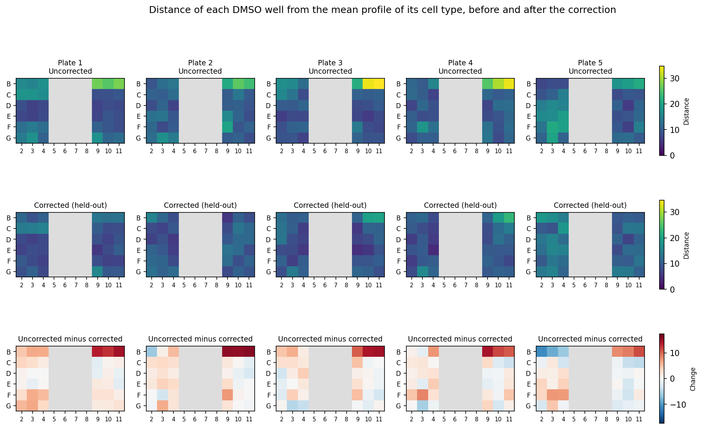

*Figure 9. The distance of each DMSO well from the mean profile of its cell type, on the layout of each plate: uncorrected (top), after the held-out correction (middle), and the difference (bottom). The compound wells are grey.*

**7. On the plates the tilt was fit on, the row effect is gone.**
Here the tilt was fit on the same wells that we look at (in-sample), which a fit on its own data always favors, so these figures show what the correction removes and not how it works on a new plate (findings 4 to 6 do that).
Plate row explains 53% of PC1 and 6% of PC2 before the correction and 0% and 1% after it (Figure 10), and the horizontal stripes of the row effect on the plate layout are gone (Figure 11).
The correction leaves 12.6% of the total variance of the first 20 principal components as position, against 43.2% before, and almost all of what remains is associated with the columns, not the rows (finding 1).
What remains is mostly column structure that is confounded with the groups (the groups sit in blocks of columns, see the layout above; after the correction, plate column explains 41% of PC1; `3.effect_on_feature_space.ipynb`).

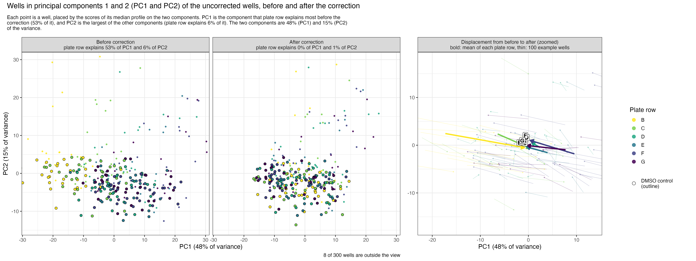

*Figure 10. Each well in PC1 and PC2 before (left) and after (middle) the correction, and the displacement of the wells (right). The tilt was fit on these wells.*


*Figure 11. The mean PC1 score at every plate position, before (top) and after (bottom) the correction, for each plate and for all plates. The horizontal stripes of the plate-row effect are gone after the correction. The tilt was fit on these wells.*

**8. The correction does not change the healthy versus failing contrast.**
The length of the healthy minus failing DMSO difference is 12.8 to 14.5 on every plate before the correction and the same after it (the share that survives is 1.00), and the tilt itself predicts no difference between the positions of the healthy and the failing wells (it differs by 0; the correction changes the difference of a plate by at most 4e-09; Figure 12).
This is by design: the rows are balanced between the two cell types, and the fit does not split the column-block offsets between the group and the column effects.
The difference that survives is the one left after the fitted tilt is subtracted; it is not necessarily all biology, because the fit leaves the offsets of the three blocks of columns in the group effects.
In the screen (43 of its 44 plates; one plate has no healthy DMSO well with enough cells) the median over plates is 0.84, but it hides large differences between platemaps: the correction makes the difference 1.5 to 2.1 times longer on platemaps 1 to 4 (single plates up to 3.1 times), and keeps 0.40 to 0.85 of it on platemaps 5 to 11 (Figure 13; see [`6.compare_position_effects_in_validation_to_screen.ipynb`](./6.compare_position_effects_in_validation_to_screen.ipynb)).

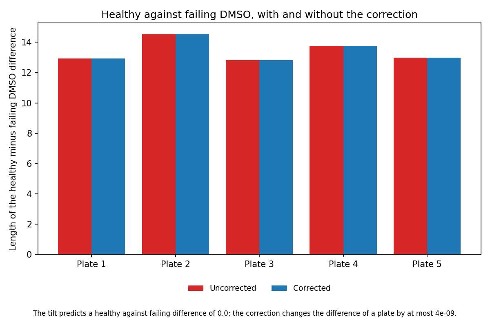

*Figure 12. The length of the healthy minus failing DMSO difference on each plate, before and after the correction.*

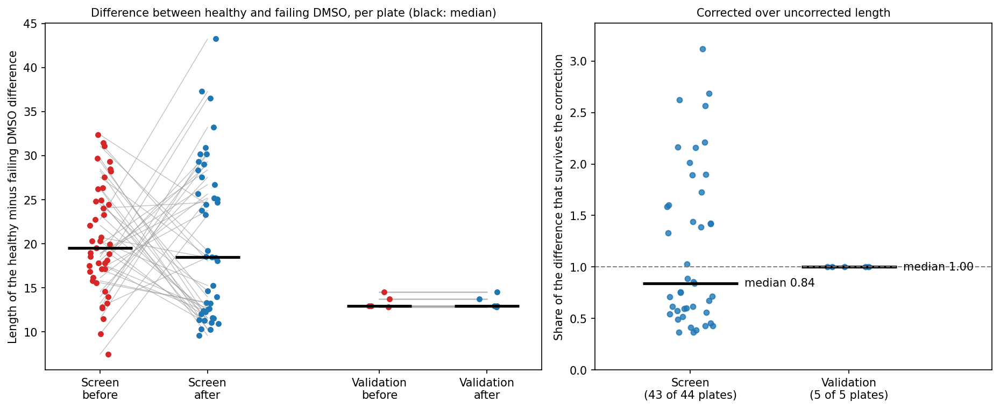

*Figure 13. Left: the length of the difference on every plate, before and after the correction, in the screen and on the validation plates. Right: the share that survives (the axis follows the data; the screen has one plate without both DMSO groups, which is left out).*

**9. The row effect of one cell type predicts the row pattern of the other.**
The failing DMSO is in columns 2, 4, and 10 and the healthy DMSO in columns 3, 9, and 11, so a tilt fit on one cell type has no observation for the columns of the other, and what it predicts for the other cell type varies only by row.
We therefore compared the row patterns (six rows): the tilt fit on the failing DMSO predicts the row pattern of the healthy DMSO, and the reverse (Figure 14).
The cosine between the predicted and the observed row pattern is 0.92 in both directions, while the row patterns of two halves of the plates of the same cell type agree at 0.90 and 0.92 (a noise reference, not an upper bound for a prediction).
The prediction for the healthy wells has about the right size (slope 1.09), and the prediction for the failing wells has 0.78 of it.
So the row effect moves the two cell types in nearly the same way.
**This layout cannot test whether the column effects carry over between cell types**, so the column terms of one shared tilt are not validated by this test.

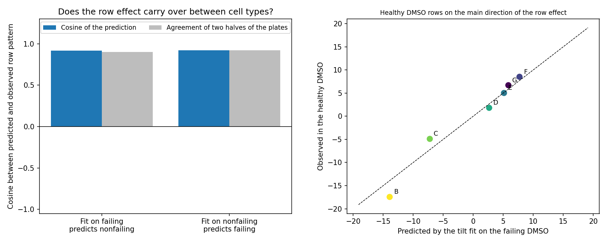

*Figure 14. Does the row effect carry over between cell types? Left: the cosine between the predicted and the observed row pattern, with the agreement of two halves of the plates. Right: the observed row pattern of the healthy DMSO against the one that the tilt fit on the failing DMSO predicts, on the main direction of the row effect (one point per row).*

**10. Some terms of the tilt are poorly determined.**
Leaving out each plate in turn, the five terms of the rows C to G against row B are 5 to 7 times larger than their uncertainty (Figure 15).
None of the nine column terms is more than 2 times its uncertainty (1.0 to 2.0), so the column effects are not determined by these plates, in line with the fact that they are confounded with the groups and do not carry over between plates.
Only two of the column terms are identified by the layout: `Column 4 vs 2` and `Column 10 vs 2` compare columns of the same block (the failing DMSO). The other seven cross two blocks, and adding a constant to the healthy columns and subtracting it from the healthy DMSO group effect leaves every fitted profile unchanged but changes them, so they depend on the ridge convention (hatched in Figure 15); a small jackknife uncertainty would only show that they are stable under that convention.
The rows are well determined and the columns are not.

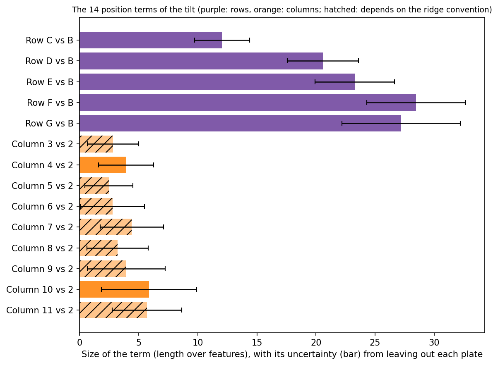

*Figure 15. The size of each row and column term of the tilt, with its uncertainty (bar) from leaving each plate out in turn. Hatched bars are column terms that cross two blocks of columns and depend on the ridge convention.*

**11. In the screen, compounds were not placed independently of position.**
The number of the compound identifier rises with the position on the plate on platemaps 5, 7, 8, and 10 (Spearman correlation 0.49 to 0.71, p < 0.001), and does not on platemaps 1, 2, 3, 6, 9, and 11 (Figure 16).
The pathways do not differ by plate row within the platemaps (a permutation test that shuffles the pathways within each platemap: p = 0.66, 550 compounds and 23 pathways; the controls `DMSO` and `TGFRi` are left out).
So compounds were not placed independently of position on some platemaps, which the tilt of the screen assumes.

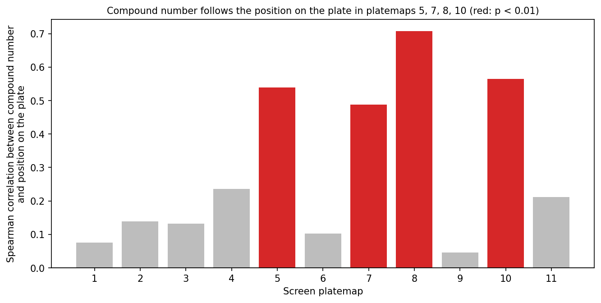

*Figure 16. The Spearman correlation between the compound number and the position on the plate, for each screen platemap (red: p < 0.01).*

## Assumptions and limits

- Position adds the same fixed vector to every cell of a well, the same for every compound and cell type (additive, no interaction of row and column, no effect that differs between compounds or cell types).
  Finding 9 tests the last part for the rows, where it is approximately true between the two cell types; this layout cannot test it for the columns.
- The five replicate plates share the DMSO layout, so they reduce noise, but the compounds are on one plate each.
  The compound effects are fit, not replicated, and the 8 positions of a compound (columns 5 to 8, in all six rows) are what separate its effect from position.
- The groups sit in blocks of columns (failing DMSO in columns 2, 4, and 10, healthy DMSO in 3, 9, and 11, compounds in 5 to 8), so a column effect is confounded with the cell type and the compounds, and only the differences between columns inside a block are determined.
  The column terms of the tilt are therefore not reliable, and the row terms carry the correction.
- The held-out test is held out by plate, so it tells how the correction works for a new plate on this layout, not for a new layout.
- We use wells with at least 50 cells, and we drop features with a missing value in any well (no feature of these data has one on any plate, so the features are the same for every plate).
- The principal-component figures fit the components on the uncorrected wells and project the corrected wells into them, as in the screen.

## Contents

```text
4a.position_correction/
├── 0.diagnose_position_effect.ipynb                          Diagnose the uncorrected plates
├── 1.fit_position_correction.ipynb                           Fit the tilt
├── 2.validate_position_correction.ipynb                      Test it on held-out plates
├── 3.effect_on_feature_space.ipynb                           Tables of the effect on the features and the wells
├── 4.plot_effect_on_feature_space.ipynb                      Figures of the effect (R)
├── 5.quantify_position_effect.ipynb                          Measure the position effect directly
├── 6.compare_position_effects_in_validation_to_screen.ipynb  Compare the validation plates with the screen
├── nbconverted/                                              Script version of each notebook
├── position_correction_fit.npz                               The tilt map and amplitude (committed; step 4b reads it)
├── results/                                                  Tables that later notebooks read
├── figures/                                                  Figures (diagnostics/, fit/, validation/, effect/, quantify/, compare_to_screen/)
└── well_medians.parquet                                      Median profile of every well (git ignores this cache)
```
