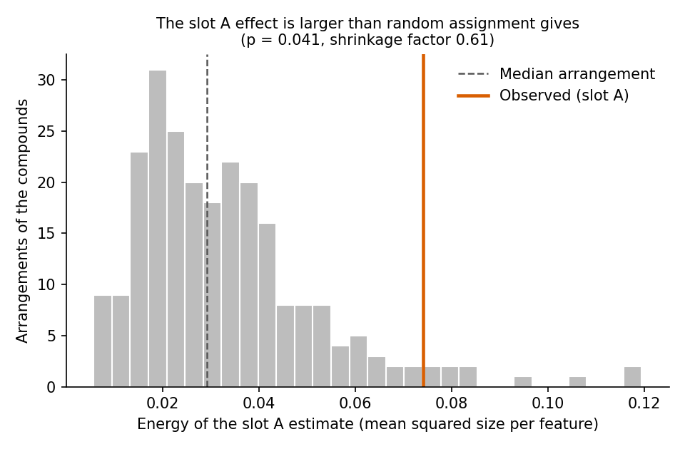
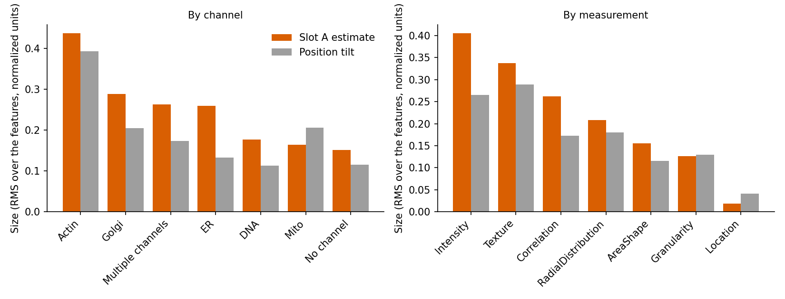
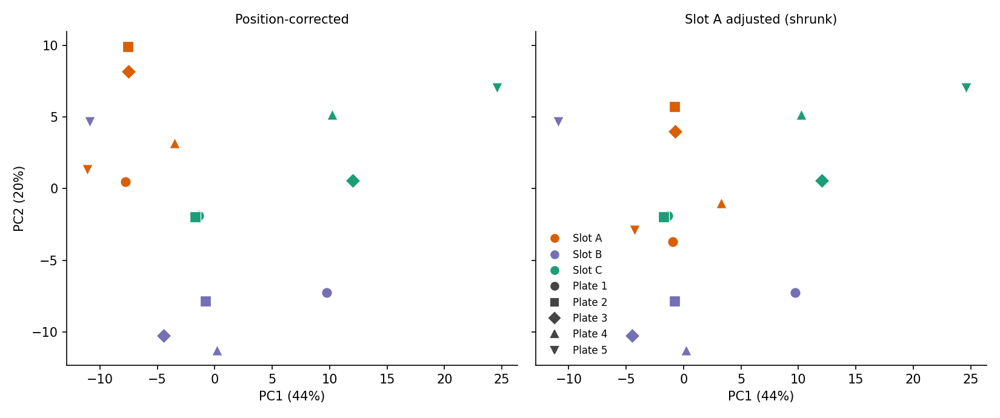

# Slot A adjustment of the validation plates (step 4c)

The position correction of step 4a removes a row plus column tilt.
It does not remove an effect of the *slot* of a compound, and the compounds of one slot score lower than those of the other two on all five plates.
This step estimates that effect, and writes **new** profiles in which a shrunk part of it is removed from the compounds of that slot.
The position-corrected profiles of steps 4b and 5 are not changed, and the new files have their own names.

## The takeaway

- **A slot is a fixed set of eight compound wells.** Every plate has three compounds, and they rotate through the 24 compound wells in the same pattern on every plate, so each well position holds the compound of one slot (A, B, or C) on every plate. The compounds were dispensed into the slots at random.
- **Slot A scores lower than slots B and C.** In the rescue score of the [hit calling repository](https://github.com/WayScience/cardiac_fibrosis_rescue_screen_hit_calling), the compound in slot A has the lowest score of the three on all five plates (p = 0.012 if the compounds were placed at random), and it is below slot B and below slot C on every plate.
- **The tilt cannot remove it.** A compound sits in the wells of one slot only, so on a plate the effect of the slot is the effect of the compound. The position correction has an offset for every compound, which absorbs it. In a joint fit of the tilt and a slot effect the tilt changed by less than 3%, because the slots are balanced over rows and columns, so we keep the slot adjustment a separate step.
- **We estimate the effect, and we trust part of the estimate.**
  - The estimate is the profile of the compound in slot A minus the mean of the two others, averaged over the five plates (one value for each of the 2,453 features).
  - Five compounds per slot also differ by chance, so we permute which compound of each plate is the one of slot A (243 arrangements). The estimate is larger than 95.9% of them (p = 0.041).
  - The share of the estimate that random assignment does not give is **61%**, and the adjustment subtracts that share: `0.61 x estimate`.
- **Only slot A is adjusted.** Slot B against slot C is not different from chance (p = 0.19, and five plates cannot give a p-value below 0.03), so we leave both alone.
- **It is an adjustment under an assumption, not a measured correction.** It assumes that the compounds of slot B and C are unbiased, and that the five compounds of slot A are on average like the others. The estimate depends on one plate (see "How stable is the estimate?"), and a calibration plate with DMSO in all the compound wells would measure the slot effect directly.

*The energy (mean squared size per feature) of the slot A estimate for each of the 243 arrangements of the compounds in the slots, and for the real one.*

## New profiles

All files are in `../data/` (git ignores it), next to the profiles that they come from.

| New file | From |
|---|---|
| `<plate>_sc_slot_a_adjusted.parquet` | `<plate>_sc_position_corrected.parquet` (all features) |
| `<plate>_sc_slot_a_adjusted_feature_selected.parquet` | the features of `<plate>_sc_position_corrected_feature_selected.parquet` |
| `bulk_slot_a_adjusted_feature_selected.parquet` | `bulk_position_corrected_feature_selected.parquet` |
| `slot_a_adjustment.npz` | a copy of [`slot_a_adjustment.npz`](./slot_a_adjustment.npz): the estimate, the shrinkage factor, and the estimates without each plate |

- Every cell and well has two more columns: `Metadata_slot` (A, B, or C for the compound wells, missing for the controls) and `Metadata_slot_a_adjusted` (true for the cells and wells that were shifted, the compounds in slot A wells).
- Controls and the compounds in slots B and C are not changed, and neither is the position tilt.
- The feature-selected files keep the features of step 4b, so the only difference to the position-corrected profiles is the shift. Feature selection is not run again.
- The bulk profiles are shifted like the cells: the median of cells that all shift by the same vector is the median shifted by that vector. The median of the adjusted cells of every well equals the adjusted bulk profile of the well (the largest difference is 2e-16, [`results/slot_a_adjustment_summary.csv`](./results/slot_a_adjustment_summary.csv)).
- Like step 4b and 5, step 4c saves locally only. Copy the files to the folder that the hit calling reads (`validation_profiles/` on bandicoot) to use them there.

## Notebooks

Run them in order from this folder.
The pipeline script `../preprocess_features.sh` does not run this step.

| Notebook | What it does | Output |
|---|---|---|
| [`0.estimate_slot_a_effect.ipynb`](./0.estimate_slot_a_effect.ipynb) | Estimates the slot A vector from the position-corrected well medians of the 15 compounds, its permutation null, the shrinkage factor, and the estimate without each plate | `slot_a_adjustment.npz`, `results/slot_a_*.csv`, `figures/` |
| [`1.apply_slot_a_adjustment.ipynb`](./1.apply_slot_a_adjustment.ipynb) | Writes the adjusted single-cell and bulk profiles and checks them | the new profiles, `results/slot_a_adjustment_summary.csv` |

Every notebook has a script version in [`nbconverted/`](./nbconverted/), and the code is in [`../../../utils/slot_adjustment_utils.py`](../../../utils/slot_adjustment_utils.py).
Notebook 0 needs the cache of the well medians of step 4a (`../4a.position_correction/well_medians.parquet`) and the committed fit.

## Which features carry the effect?

The slot A estimate is largest in the Actin channel and in intensity, texture, and correlation features, like the position tilt, and it is larger than the tilt in most of them.

*Size (root mean square over the features, in normalized units) of the slot A estimate and of the position tilt, by channel (left) and by measurement type (right).*

## How stable is the estimate?

We made the estimate without each plate in turn (four plates, 81 arrangements):

| Plate left out | Energy | p-value | Shrinkage factor | Cosine with the full estimate |
|---|---|---|---|---|
| 1 | 0.076 | 0.099 | 0.50 | 0.984 |
| 2 | 0.077 | 0.124 | 0.45 | 0.977 |
| 3 | 0.069 | 0.124 | 0.50 | 0.980 |
| 4 | 0.082 | 0.099 | 0.51 | 0.995 |
| 5 | 0.082 | 0.025 | 0.66 | 0.959 |

The direction of the estimate is stable (cosine 0.96 to 0.995), and the shrinkage factor is 0.45 to 0.66.
With four plates the smallest possible p-value is 1/81 = 0.012. Without plate 5 the p-value is 0.025, and without any other plate it is 0.10 to 0.12.
The hit calling carries this spread into the scores.

*The profile of every compound (the mean of its 8 position-corrected wells) in the first two principal components of the 15 compounds, before (left) and after (right) the adjustment of slot A.*

## What the adjustment cannot do

- **It cannot tell the slot effect from the compounds of slot A.** The five compounds of slot A are different on every plate, so the estimate also holds what these five compounds do. The shrinkage takes off the part that random assignment gives, which is a statement about the size of the estimate and not about each compound.
- **It rests on five plates.** The estimate changes when a plate is left out, and the permutation test cannot give a p-value below 1/243.
- **It does not say what the effect is.** It could be a position effect that a row plus column tilt cannot represent, or something about how the wells of slot A were handled, such as the order or the channel of the dispensing.
- **It is not run by the pipeline script,** and the hit calling uses the new profiles next to the position-corrected ones so that the two can be compared.
