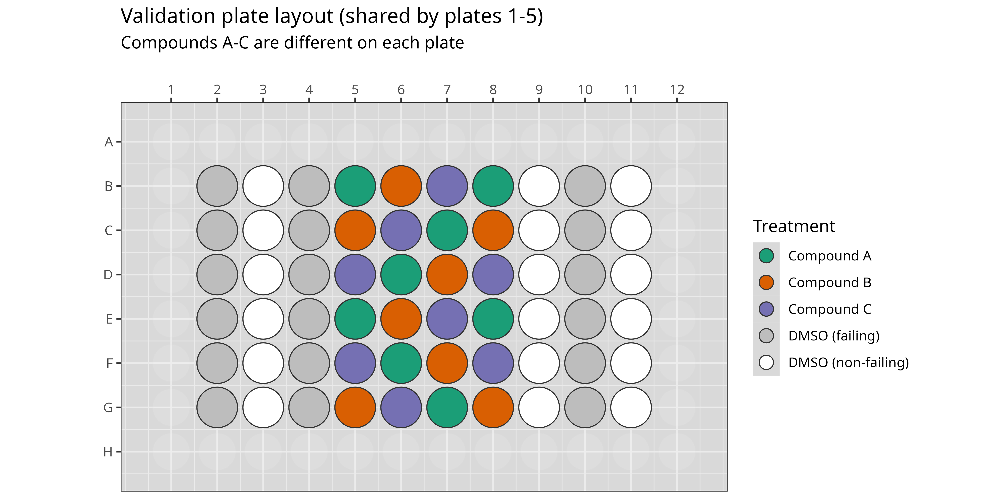

# Validation plate metadata

This folder holds one plate map per validation plate.

| File | What it is |
| --- | --- |
| [`platemaps/`](./platemaps/) | One plate map CSV per plate, named `<plate barcode>_platemap.csv`, with one row per well: plate barcode, plate number, well position, heart number, cell type, heart failure type, and treatment |
| [`edit_metadata_excel_file.ipynb`](./edit_metadata_excel_file.ipynb) | Splits the plate map Excel file (one treatment column per plate) into the per-plate CSVs |
| [`platemap_vis.ipynb`](./platemap_vis.ipynb) | Checks that all plates share the same layout and draws the general plate map figure in [`platemap_fig/`](./platemap_fig/) |
| [`metadata_env.yml`](./metadata_env.yml) | Conda environment for the Python notebook |

## Plate layout

All five plates use the same 60 wells in the same layout. 
Only the compounds change from plate to plate.

- 3 compounds (A, B, C) on failing cells (heart 25, dilated cardiomyopathy), 8 wells each
- DMSO on failing cells (heart 25), 18 wells: the negative control used for bulk normalization
- DMSO on non-failing cells (heart 7), 18 wells: the non-failing control

The compound in each slot on each plate is listed in the [module README](../README.md).

