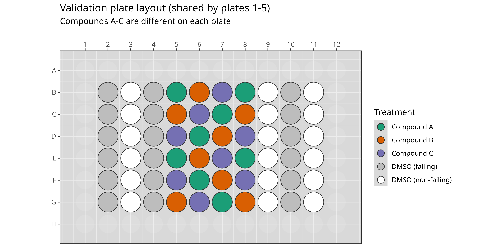

# Cardiac Fibrosis Rescue Screen Profiling

This repository contains the image analysis and image-based profiling pipeline for a cardiac fibroblast drug screen.
It turns raw Cell Painting images into single-cell and bulk (well-level) morphology profiles for the 44 screen plates and the 5 validation plates.
This repository does not train models or call hits.
The [cardiac_fibrosis_rescue_screen_hit_calling](https://github.com/WayScience/cardiac_fibrosis_rescue_screen_hit_calling) repository uses the profiles for those analyses.

## The screen

- 11 plate map layouts with 4 replicate plates each (44 plates in three batches), plus five validation plates (see below)
- 550 small molecule treatments and two controls: DMSO-treated failing and non-failing (healthy) cells
- A modified Cell Painting stain that swaps the RNA/nucleoli stain for F-actin, giving five channels:
  nuclei (d4), endoplasmic reticulum (d3), Golgi/plasma membrane (d2), mitochondria (d1), and F-actin (d0)


> This plate map layout is the same for plates 1 through 10.


> This plate map layout is specific to plate 11, which is a partial plate.

## The validation plates

Five validation plates test the compounds that the screen called hits (module [`5.validation_plate_profiling`](./5.validation_plate_profiling/)).
They use the same five-channel stain as the screen.

- 15 compounds, three on each plate in 8 wells each, so a compound is on one plate only
- DMSO controls on failing (heart 25, dilated cardiomyopathy) and non-failing (healthy, heart 7) cells, 18 wells of each on every plate
- All five plates share one layout of 60 wells: the two kinds of DMSO sit in blocks of columns that cover all six rows, and the compounds sit in columns 5 to 8



> This plate map layout is the same for all five validation plates; only the compounds change.

The validation plate profiles are corrected for plate-position effects with a fit that uses the controls and the compounds of all plates (step `4a.position_correction` of the module).
The [hit-calling repository](https://github.com/WayScience/cardiac_fibrosis_rescue_screen_hit_calling) calls the hits of the validation plates from these profiles.

## Pipeline

Each numbered module has a README with details and a bash script that runs it.

| Module | What it does |
|---|---|
| [`0.download_data`](./0.download_data/) | Instructions for downloading the images |
| [`1.whole_image_qc`](./1.whole_image_qc/) | Flag over-saturated and blurry images with CellProfiler |
| [`2.illumination_correction`](./2.illumination_correction/) | Correct uneven illumination and skip images that fail QC |
| [`3.cellprofiler_processing`](./3.cellprofiler_processing/) | Segment cells and extract morphology features with CellProfiler |
| [`4.image_based_profiling`](./4.image_based_profiling/) | Convert features to parquet, filter poor-quality cells, normalize, correct plate-position effects, and aggregate to **single-cell** and **bulk** profiles |
| [`5.validation_plate_profiling`](./5.validation_plate_profiling/) | Runs the same steps (illumination correction through bulk profiles) on the five validation plates, and corrects their plate-position effects (diagnosis, fit, and evaluation in `4a.position_correction`) |

Supporting folders:

- [`metadata`](./metadata/): plate maps and barcodes, including treatment and pathway annotations
- [`utils`](./utils/): shared helper functions
- [`environments`](./environments/): the conda environment for CellProfiler (the uv Python environment is defined by [`pyproject.toml`](./pyproject.toml) and [`uv.lock`](./uv.lock) in the repository root)

## Environments

1. [CellProfiler environment](./environments/cellprofiler_env.yml) (`fibrosis_cp_env`): CellProfiler, for image QC, illumination correction, and feature extraction (modules 1, 2, 3, and the validation plate equivalents)
2. Python environment (a [uv](https://docs.astral.sh/uv/) project: [`pyproject.toml`](./pyproject.toml) and [`uv.lock`](./uv.lock)): pycytominer, CytoTable, and coSMicQC, for image-based profiling (module 4 and the validation plates' profiling)

The profiles depend on the pycytominer version, so the lockfile pins pycytominer 1.7.1 and the packages that the existing profiles were checked with.
Create the environments from the root of this repository:

```bash
mamba env create -f environments/cellprofiler_env.yml
uv sync --locked
```

[`environments/hpc_create_envs.sh`](./environments/hpc_create_envs.sh) creates the CellProfiler environment on a Slurm cluster. Run `uv sync --locked` there for the Python environment.

## Outputs

The pipeline produces single-cell and bulk profiles, which module 4 documents in detail.
Large intermediate files, such as images and parquet files, are not tracked by git.
